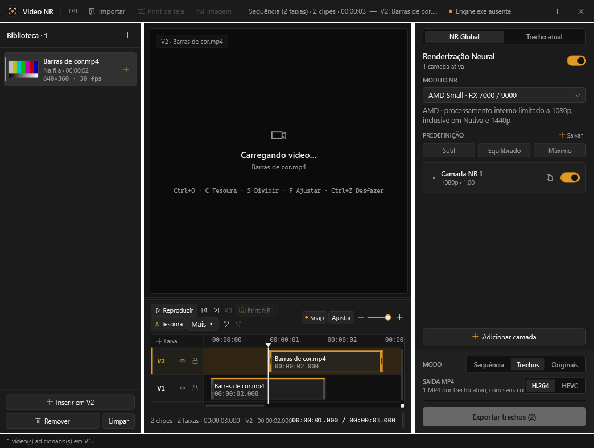
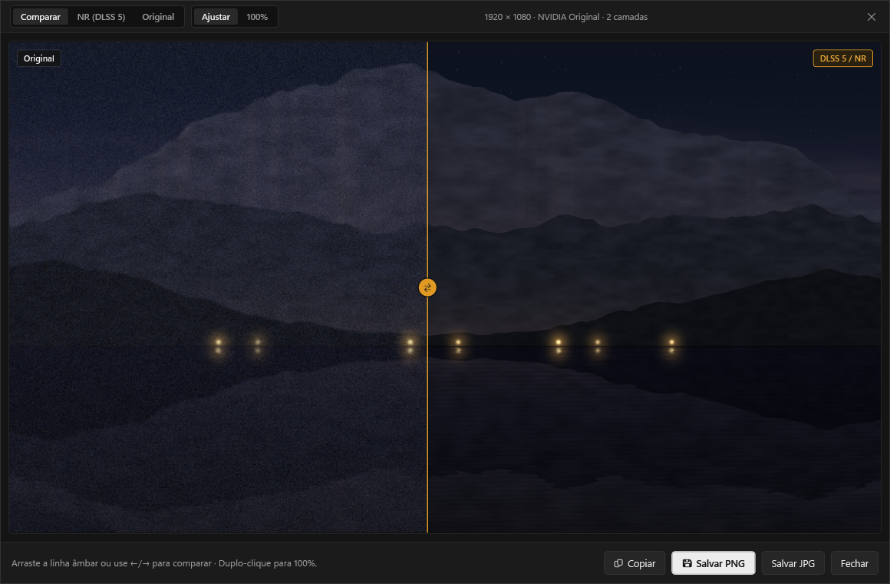

# Video NR

**English** · [Português (BR)](README.pt-BR.md) · [简体中文](README.zh-CN.md)

Video editor for Windows 11 x64. Arrange clips on up to six tracks, apply neural rendering on the GPU, and export MP4 files. Each portable package includes the Veyra engine for the selected GPU vendor.



## Editing and export

Drag clips from the library onto the timeline. The highest visible track with an enabled segment wins each overlap. Playback and sequence export skip gaps. Lock a track to protect its contents. Split at the playhead, drag an edge, or enter source times in `HH:MM:SS.mmm`.

| Mode in the editor | Output |
| --- | --- |
| Sequência | One MP4 of the visible edit. When joining segments, the first sets the frame size. Other aspect ratios are letterboxed. The first audio track of each part is joined as stereo AAC. |
| Trechos | One MP4 per enabled segment on visible tracks, including covered segments. Each keeps its source trim and NR settings. |
| Originais | One MP4 per full library file with the global NR profile. |

The global profile supports four layers with individual resolution, intensity, tone and structure. Select a segment to override that profile. AMD neural processing is capped at 1080p internally, including the Native and 1440p options.

## Video frames and stills

Press `P` for the current frame, `Ctrl+Shift+P` for a screen region, or `Ctrl+V` to paste. You can also open a still image. Frame stepping uses the source presentation timestamps available through Windows and supports variable frame rates.

**Sem NR** and **NR** use the same engine and output encoding for comparison. Still images enter as one uncompressed YUV frame, fitted within 4096 × 2304, with transparency composited over black. Inspect at 100%, copy the result, or save as PNG or JPEG.



## Download & Quick Start

1. Download the portable package for your GPU from [Releases](https://github.com/zezim7/Neural-Video-Reendering/releases/latest):
   - `VideoNR-NVIDIA-win64.zip` — NVIDIA RTX GPUs
   - `VideoNR-AMD-win64.zip` — AMD Radeon RX 7000 / 9000 GPUs
2. Extract the entire archive into a writable folder.
3. Launch `VideoNR.exe`.

## Requirements & Supported GPUs

- **OS:** Windows 11 x64 with up-to-date GPU drivers.

| NR Mode | Supported GPUs | Package |
| :--- | :--- | :--- |
| **NVIDIA Original** | RTX 50 series | `VideoNR-NVIDIA-win64.zip` |
| **SF310.9.16 (Performance / Legacy)** | RTX 20–50 series | `VideoNR-NVIDIA-win64.zip` |
| **AMD Small / Original** *(experimental)* | Radeon RX 7000 & RX 9000 | `VideoNR-AMD-win64.zip` |

> [!NOTE]
> AMD modes require the HIP runtime and are experimental in this editor.
> Preview and timestamp access depend on the codecs installed in Windows. Export uses the engine’s own decoder.

## Keyboard Shortcuts

### Main Editor

| Shortcut | Action |
| :--- | :--- |
| `Space` or click video | Play / Pause |
| `,` / `.` | Step back / forward by presentation timestamp |
| `←` / `→` | Seek −1s / +1s |
| `Shift` + `←` / `→` | Seek −5s / +5s |
| `I` / `O` | Mark trim start / end at current position |
| `M` | Mute / Unmute preview audio |
| `Q` | Toggle queue drawer |
| `P` | Render current video frame with NR |
| `Ctrl` + `Shift` + `P` | Screen capture print with NR |
| `Ctrl` + `V` | Paste clipboard image for NR |
| `Ctrl` + `O` | Open video files |
| `C` / `S` | Split at the playhead |
| `Ctrl+D` / `E` | Duplicate / enable or disable the selected segment |
| `G` / `F` | Close gaps on unlocked tracks / fit timeline to view |
| `Delete` | Remove the selected segment. With focus in the library, remove the library item. |
| `Shift+Delete` | Remove the segment and close the gap on its track |
| `Ctrl+Z` / `Ctrl+Y` or `Ctrl+Shift+Z` | Undo / redo |

### Print Preview (`NR`)

| Shortcut / Gesture | Action |
| :--- | :--- |
| `1` / `2` | Switch between Fit and `100%` (1:1) zoom |
| Double-click or `Ctrl` + Wheel | Toggle Fit / `100%` centered on cursor |
| Middle-drag, or Left-drag (`NR` / `Sem NR` / `Space` held) | Pan image while zoomed to `100%` |
| `←` / `→` (`Shift` + `←` / `→`) | Nudge split divider ±2% (±10%) in Compare mode |
| `Ctrl` + `C` | Copy rendered image to clipboard |
| `Ctrl` + `S` | Save rendered image as PNG |
| `Esc` | Close preview |

## Build & Test

### Prerequisites
- [.NET 8 SDK](https://dotnet.microsoft.com/download/dotnet/8.0)
- **MSVC x64** (`cl.exe`, via *Developer PowerShell for VS*) or **MinGW-w64 `g++`** with C++20 support
- **Python 3.11+** *(only required to assemble offline portable ZIPs)*

### Commands

```powershell
# Run unit tests
dotnet run --project Tests/VideoNR.Tests.csproj
dotnet run --project Tests.Windows/VideoNR.WindowsTests.csproj

# Build the editor (build/VideoNR.exe) and native adapter (build/Engine.exe)
./Build.ps1

# Build self-contained and package portable ZIPs into dist/
./Build.ps1 -SelfContained
python scripts/package-windows.py
```

### Repository Structure

```text
├── App/                        # .NET 8 WPF application
│   ├── Assets/                 # Multi-resolution application icon
│   ├── Helpers/                # DWM dark mode and window chrome helpers
│   ├── Imaging/                # GDI screen capture, WIC I/O, video thumbnails & FPS probing
│   ├── Models/                 # ClipItem, NrLayer, TimelineSequence, TimelineSegment, TimelineHistory
│   ├── Services/               # EngineLocator, VideoExporter, PrintProcessor, MediaFoundationFrameCodec, MediaFoundationInterop, RawImage, SettingsStore
│   ├── Themes/                 # Shared Fluent darkroom styles and tokens
│   ├── Editor.xaml             # Main window layout
│   ├── Editor.xaml.cs          # Window chrome, queue, presets, shortcuts
│   ├── Editor.Playback.cs      # Player, time ruler, trim, scrubbing & presentation-timestamp stepping
│   ├── Editor.Export.cs        # Batch export and NR print workflows
│   ├── PrintPreviewWindow.*    # Interactive before/after & 1:1 pan/zoom inspection modal
│   └── ScreenCaptureOverlay.*  # Multi-monitor region capture overlay
├── Engine.cpp                  # Native C++20 shared-memory adapter (supports --max-frames)
├── Tests/                      # Unit tests (.NET 8)
├── docs/screenshots/           # Application screenshots
├── scripts/                    # Automated Windows portable ZIP packager
└── Build.ps1                   # Windows build script
```

## License

Licensed under [GPL-3.0](LICENSE.txt). See [DEPENDENCIAS.md](DEPENDENCIAS.md) for third-party components and notices bundled in the portable packages.
