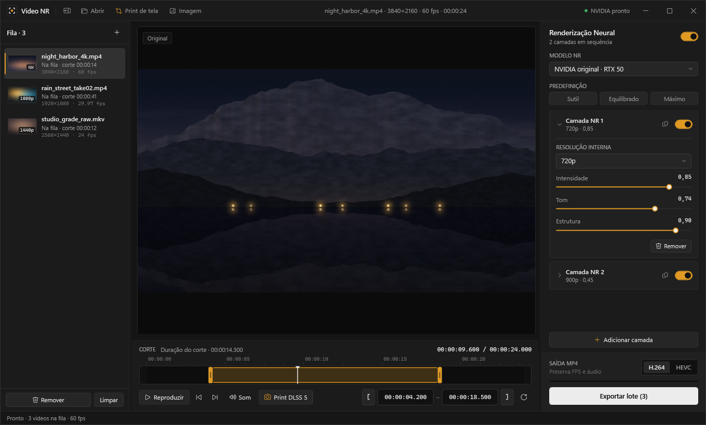
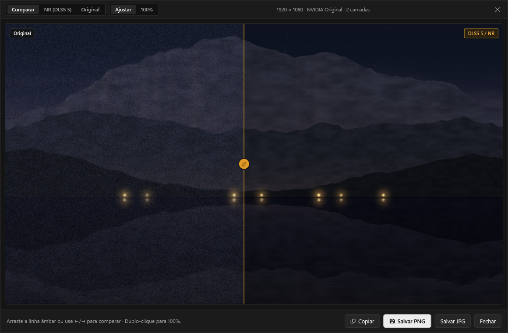

# Video NR

[English](README.md) · **Português (BR)** · [简体中文](README.zh-CN.md)

Editor, cortador e processador neural de vídeo e imagens (DLSS 5 / NR) 100% offline para Windows 11 x64. Executa localmente na GPU usando o motor Veyra incluído nos pacotes portáteis, sem nuvem e sem dependências externas.



## Recursos

- **Renderização Neural em camadas (até 4 passes)** — configure resolução interna (`480p` a `1440p` ou `Nativa`), **Intensidade**, **Tom** e **Estrutura** por camada, aplique predefinições (`Sutil`, `Equilibrado`, `Máximo`), duplique camadas ou dê duplo-clique em qualquer slider para restaurar `1.00`.
- **Print e Imagens com DLSS 5 / NR** — renderize um único frame no ponto atual do vídeo (`P`), capture uma região ou monitor da tela (`Ctrl+Shift+P`), abra imagens (`PNG`, `JPG`, `BMP`, `WEBP`, `TIFF`) ou cole da área de transferência (`Ctrl+V`). Inclui janela interativa de comparação antes/depois com zoom `100%` (1:1), arrasto para mover (pan), alternância de zoom no ponto do cursor, cópia para a área de transferência e salvamento em PNG/JPG.
- **Corte preciso e fila com miniaturas** — navegue pela régua de tempo, avance frame a frame (`,` / `.`) usando o FPS real detectado do clipe (com fallback para `30 fps`), arraste as alças de corte ou digite limites em `HH:MM:SS.mmm`. A fila lateral exibe miniaturas reais, resolução e FPS detectados de cada clipe e guarda cortes independentes por vídeo.
- **Exportação em lote para MP4 (H.264 / HEVC)** — arraste vídeos ou pastas para a janela e exporte tudo em sequência preservando resolução, FPS e faixas de áudio compatíveis.
- **Interface nativa Windows 11** — UI .NET 8 WPF com barra de título integrada (`WindowChrome`), ícones `Segoe Fluent Icons`, suporte a DPI Per-Monitor v2 e salvamento automático das preferências.



## Download e uso rápido

1. Baixe o pacote portátil para a sua GPU em [Releases](https://github.com/zezim7/Neural-Video-Reendering/releases/latest):
   - `VideoNR-NVIDIA-win64.zip` — placas NVIDIA RTX
   - `VideoNR-AMD-win64.zip` — placas AMD Radeon RX 7000 / 9000
2. Extraia todo o conteúdo do ZIP para uma pasta gravável.
3. Abra o `VideoNR.exe`.

## Requisitos e GPUs compatíveis

- **Sistema operacional:** Windows 11 x64 com drivers de GPU atualizados.

| Modo NR | GPUs compatíveis | Pacote |
| :--- | :--- | :--- |
| **NVIDIA original** | RTX série 50 | `VideoNR-NVIDIA-win64.zip` |
| **SF310.9.16 (desempenho / legado)** | RTX séries 20 a 50 | `VideoNR-NVIDIA-win64.zip` |
| **AMD Small / Original** *(experimental)* | Radeon RX 7000 e RX 9000 | `VideoNR-AMD-win64.zip` |

> [!NOTE]
> Os modos AMD exigem o runtime HIP instalado e estão em fase experimental neste editor.
> O preview utiliza os codecs instalados no Windows; arquivos sem codec de preview no sistema (ex: MKV/HEVC) ainda podem ser exportados e processados em print normalmente pelo motor.

## Atalhos de teclado

### Editor principal

| Atalho | Ação |
| :--- | :--- |
| `Espaço` ou clique no vídeo | Reproduzir / Pausar |
| `,` / `.` | Voltar / Avançar 1 frame (usa o FPS real do clipe) |
| `←` / `→` | Voltar / Avançar 1 segundo |
| `Shift` + `←` / `→` | Voltar / Avançar 5 segundos |
| `I` / `O` | Marcar início / fim do corte no ponto atual |
| `M` | Silenciar / Ativar áudio do preview |
| `Q` | Mostrar / Ocultar fila lateral |
| `P` | Renderizar frame atual do vídeo com DLSS 5 / NR |
| `Ctrl` + `Shift` + `P` | Capturar tela e aplicar DLSS 5 / NR |
| `Ctrl` + `V` | Colar imagem da área de transferência para DLSS 5 / NR |
| `Ctrl` + `O` | Abrir vídeos |
| `Delete` | Remover o vídeo selecionado da fila |

### Visualização de Print (`DLSS 5 / NR`)

| Atalho / Gesto | Ação |
| :--- | :--- |
| `1` / `2` | Alternar entre Ajustar e `100%` (1:1) |
| Duplo-clique ou `Ctrl` + Roda | Alternar Ajustar / `100%` focado no cursor |
| Botão do meio, ou arrastar (`NR` / `Original` / segurando `Espaço`) | Mover imagem (pan) no zoom `100%` |
| `←` / `→` (`Shift` + `←` / `→`) | Ajustar divisória ±2% (±10%) no modo Comparar |
| `Ctrl` + `C` | Copiar imagem renderizada para a área de transferência |
| `Ctrl` + `S` | Salvar imagem renderizada em PNG |
| `Esc` | Fechar visualização |

## Compilar e testar

### Pré-requisitos
- [.NET 8 SDK](https://dotnet.microsoft.com/download/dotnet/8.0)
- **MSVC x64** (`cl.exe`, via *Developer PowerShell for VS*) ou **MinGW-w64 `g++`** com C++20
- **Python 3.11+** *(apenas para montar os ZIPs portáteis completos)*

### Comandos

```powershell
# Executar testes unitários
dotnet run --project Tests/VideoNR.Tests.csproj

# Compilar o editor (build/VideoNR.exe) e o adaptador nativo (build/Engine.exe)
./Build.ps1

# Publicar self-contained e gerar os ZIPs portáteis em dist/
./Build.ps1 -SelfContained
python scripts/package-windows.py
```

### Estrutura do repositório

```text
├── App/                        # Interface WPF (.NET 8)
│   ├── Assets/                 # Ícone multi-resolução da aplicação
│   ├── Helpers/                # Integração DWM dark mode e WindowChrome
│   ├── Imaging/                # Captura de tela GDI, leitura/escrita WIC, miniaturas e leitura de FPS
│   ├── Models/                 # ClipItem, NrLayer, TrimSelection
│   ├── Services/               # EngineLocator, VideoExporter, PrintProcessor, MediaFoundationFrameCodec, MediaFoundationInterop, RawImage, SettingsStore
│   ├── Themes/                 # Sistema visual compartilhado (Theme.xaml)
│   ├── Editor.xaml             # Layout principal
│   ├── Editor.xaml.cs          # Barra de título, fila, predefinições e atalhos
│   ├── Editor.Playback.cs      # Player, régua de tempo, corte, scrub e passo por FPS real
│   ├── Editor.Export.cs        # Exportação em lote e fluxo de Print DLSS 5
│   ├── PrintPreviewWindow.*    # Comparador antes/depois e inspeção 1:1 com pan/zoom
│   └── ScreenCaptureOverlay.*  # Overlay multi-monitor para captura de tela
├── Engine.cpp                  # Adaptador nativo C++20 (suporta --max-frames)
├── Tests/                      # Testes unitários (.NET 8)
├── docs/screenshots/           # Capturas de tela da aplicação
├── scripts/                    # Empacotamento automatizado dos ZIPs Windows
└── Build.ps1                   # Script de build Windows
```

## Licença

Distribuído sob a licença [GPL-3.0](LICENSE.txt). Consulte [DEPENDENCIAS.md](DEPENDENCIAS.md) para detalhes sobre os componentes e avisos de terceiros incluídos nos pacotes portáteis.
