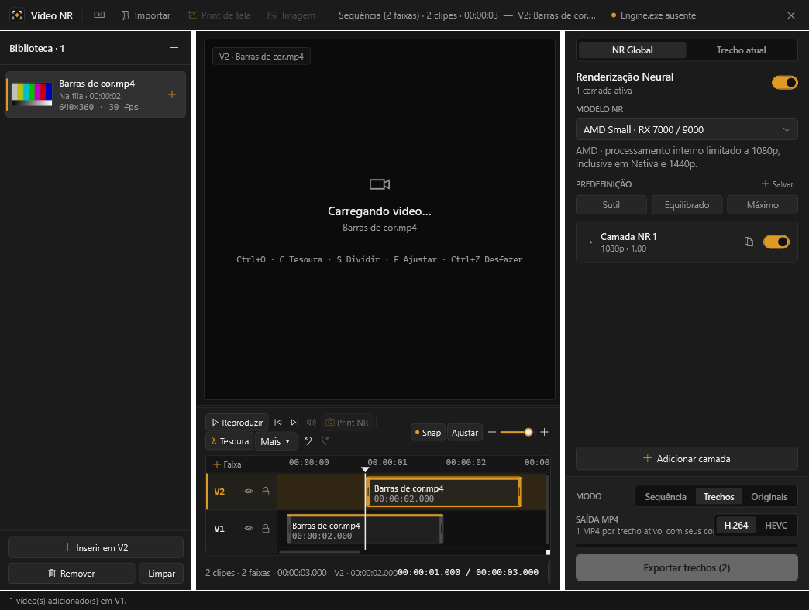
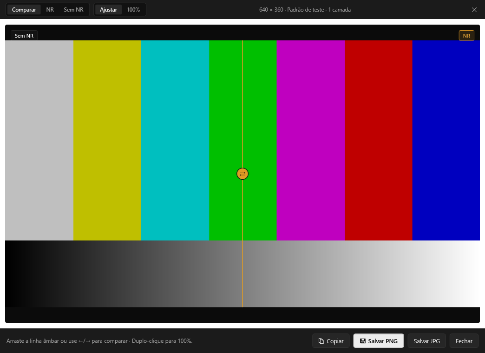

# Video NR

[English](README.md) · [Português (BR)](README.pt-BR.md) · **简体中文**

适用于 Windows 11 x64 的视频编辑器。可在最多六条轨道上剪辑、使用 GPU 进行神经渲染，并导出 MP4。每个便携包包含对应显卡厂商的 Veyra 引擎。



## 时间线与导出

将视频从素材库拖到轨道上。重叠时，使用最上方可见轨道中已启用的片段。播放及序列导出会跳过空隙。锁定轨道可保护其内容。可在播放头位置切分、拖动片段边缘，或用 `HH:MM:SS.mmm` 输入源时间码。

| 界面选项 | 输出 |
| --- | --- |
| Sequência | 将可见剪辑导出为一个 MP4。拼接时以首段尺寸为准，其他宽高比通过黑边保留；每段的第一条音轨合成为立体声 AAC。 |
| Trechos | 可见轨道上每个已启用片段单独导出，包括被遮挡的片段，保留各自的裁剪范围与 NR 设置。 |
| Originais | 将素材库中的每个完整文件使用全局 NR 设置单独导出。 |

全局 NR 最多支持四层，每层分别设置分辨率、强度、色调和结构。选中片段可覆盖全局设置。AMD 内部神经处理分辨率上限为 1080p，选择原生或 1440p 时也适用。

## 帧与静态图像

按 `P` 处理当前视频帧，按 `Ctrl+Shift+P` 截取屏幕区域，或按 `Ctrl+V` 粘贴图片。也可以打开图片文件。逐帧导航使用 Windows 提供的显示时间戳，支持可变帧率。

对比视图中，**Sem NR**（关闭 NR）与 **NR** 使用同一引擎及输出编码。静态图像以单个未压缩 YUV 帧输入，最大尺寸为 4096 × 2304，透明部分与黑色背景合成。可按 100% 查看、复制或保存为 PNG 或 JPEG。



## 下载与使用

1. 前往 [Releases](https://github.com/zezim7/Neural-Video-Reendering/releases/latest) 下载对应显卡的便携压缩包：
   - `VideoNR-NVIDIA-win64.zip` — NVIDIA RTX 显卡
   - `VideoNR-AMD-win64.zip` — AMD Radeon RX 7000 / 9000 显卡
2. 将压缩包完整解压到可写目录。
3. 运行 `VideoNR.exe`。

## 系统要求与支持的显卡

- **操作系统：** Windows 11 x64（需安装最新显卡驱动）。

| NR 模式 | 支持的显卡 | 安装包 |
| :--- | :--- | :--- |
| **NVIDIA Original** | RTX 50 系列 | `VideoNR-NVIDIA-win64.zip` |
| **SF310.9.16（性能 / 传统）** | RTX 20–50 系列 | `VideoNR-NVIDIA-win64.zip` |
| **AMD Small / Original** *（实验性）* | Radeon RX 7000 / RX 9000 | `VideoNR-AMD-win64.zip` |

> [!NOTE]
> AMD 模式需要安装 HIP 运行时，目前处于实验阶段。
> 预览和时间戳读取依赖 Windows 已安装的解码器。导出使用引擎自带的解码器。

## 快捷键

### 主编辑器

| 快捷键 | 功能 |
| :--- | :--- |
| `Space` 或点击画面 | 播放 / 暂停 |
| `,` / `.` | 按显示时间戳前后移动一帧 |
| `←` / `→` | 后退 / 前进 1 秒 |
| `Shift` + `←` / `→` | 后退 / 前进 5 秒 |
| `I` / `O` | 在当前位置标记剪辑入点 / 出点 |
| `M` | 静音 / 取消静音预览音频 |
| `Q` | 显示 / 隐藏队列侧栏 |
| `P` | 使用 NR 渲染当前视频帧 |
| `Ctrl` + `Shift` + `P` | 屏幕截图并应用 NR |
| `Ctrl` + `V` | 粘贴剪贴板图片应用 NR |
| `Ctrl` + `O` | 打开视频文件 |
| `C` / `S` | 在播放头切分 |
| `Ctrl+D` / `E` | 复制 / 启用或停用所选片段 |
| `G` / `F` | 闭合未锁定轨道的空隙 / 适应时间线宽度 |
| `Delete` | 删除所选片段；焦点位于素材库时移除库内项目 |
| `Shift+Delete` | 删除片段并闭合该轨的空隙 |
| `Ctrl+Z` / `Ctrl+Y` 或 `Ctrl+Shift+Z` | 撤销 / 重做 |

### 对比预览窗口（`NR`）

| 快捷键 / 操作 | 功能 |
| :--- | :--- |
| `1` / `2` | 切换「适应窗口」与 `100%`（1:1）缩放 |
| 双击画面或 `Ctrl` + 滚轮 | 以光标为中心切换适应 / `100%` |
| 中键拖动，或在 `NR` / `Sem NR` 模式及按住 `Space` 时左键拖动 | `100%` 缩放下平移画面 |
| `←` / `→`（`Shift` + `←` / `→`） | 对比模式下微调分割线 ±2%（±10%） |
| `Ctrl` + `C` | 复制渲染结果到剪贴板 |
| `Ctrl` + `S` | 将渲染结果保存为 PNG |
| `Esc` | 关闭预览窗口 |

## 构建与测试

### 环境要求
- [.NET 8 SDK](https://dotnet.microsoft.com/download/dotnet/8.0)
- **MSVC x64**（`cl.exe`，推荐使用 *Developer PowerShell for VS*）或支持 C++20 的 **MinGW-w64 `g++`**
- **Python 3.11+** *（仅在打包完整离线便携 ZIP 时需要）*

### 命令

```powershell
# 运行单元测试
dotnet run --project Tests/VideoNR.Tests.csproj
dotnet run --project Tests.Windows/VideoNR.WindowsTests.csproj

# 在兼容 GPU 上验证解压后的便携包，保存测试图、两种渲染结果、裁剪后的 MP4 和参数
dotnet run --project Tests.Windows/VideoNR.WindowsTests.csproj -- --verify-package C:\VideoNR .\results

# 编译编辑器 (build/VideoNR.exe) 与原生适配器 (build/Engine.exe)
./Build.ps1

# 发布独立版并在 dist/ 中打包便携 ZIP
./Build.ps1 -SelfContained
python scripts/package-windows.py
```

手动运行 GitHub Actions 会在 Windows 上生成并打开两个便携包；勾选发布选项即可创建发行版。

### 项目结构

```text
├── App/                        # .NET 8 WPF 应用
│   ├── Assets/                 # 多分辨率应用图标
│   ├── Helpers/                # DWM 深色模式与 WindowChrome 辅助类
│   ├── Imaging/                # GDI 截图、WIC 图片读写、视频缩略图与帧率探测
│   ├── Models/                 # ClipItem, NrLayer, TimelineSequence, TimelineSegment, TimelineHistory
│   ├── Services/               # EngineLocator, VideoExporter, PrintProcessor, MediaFoundationFrameCodec, MediaFoundationInterop, RawImage, SettingsStore
│   ├── Themes/                 # 共享暗室样式主题 (Theme.xaml)
│   ├── Editor.xaml             # 主界面布局
│   ├── Editor.xaml.cs          # 标题栏、队列、预设与快捷键
│   ├── Editor.Playback.cs      # 播放器、时间标尺、剪辑、拖动与按显示时间戳逐帧步进
│   ├── Editor.Export.cs        # 批量导出与 NR 截图处理流程
│   ├── PrintPreviewWindow.*    # 交互式前后对比与 1:1 平移缩放预览窗口
│   └── ScreenCaptureOverlay.*  # 多显示器区域截图遮罩窗口
├── Engine.cpp                  # 原生 C++20 共享内存适配器（支持 --max-frames）
├── Tests/                      # 单元测试 (.NET 8)
├── docs/screenshots/           # 应用界面截图
├── scripts/                    # Windows 便携 ZIP 打包脚本
└── Build.ps1                   # Windows 构建脚本
```

## 许可证

本项目基于 [GPL-3.0](LICENSE.txt) 开源。便携包中包含的第三方组件与声明详见 [DEPENDENCIAS.md](DEPENDENCIAS.md)。
